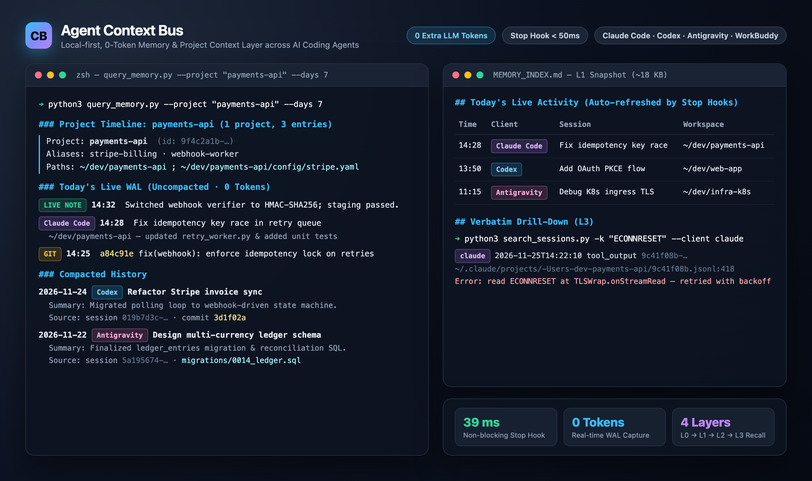
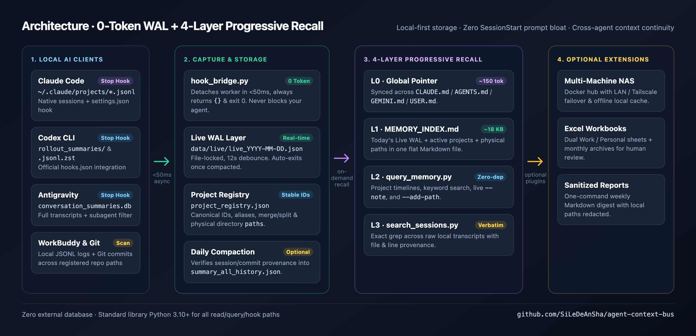

<div align="center">

# Agent Context Bus

**Stop re-explaining your project every time you switch AI coding agents.**

Local-first, **0-token** real-time memory, **SQLite FTS5** search & project context bus across **Claude Code**, **Codex CLI**, **Antigravity**, and **WorkBuddy**.

[](LICENSE)
[](https://github.com/SiLeDeAnSha/agent-context-bus/releases/tag/v0.5.1)
[](https://www.python.org/)
[](#how-it-works)
[](#real-time-0-token-wal--stop-hooks)

**English** | [简体中文](README_CN.md)

</div>

---

<p align="center">
  
</p>

## Why Agent Context Bus?

If you bounce between **Claude Code**, **Codex**, **Antigravity**, and **WorkBuddy**, every tool keeps its own siloed history. Switching agents mid-task means re-explaining where your repo lives, which config file you just edited, what broke ten minutes ago, and which architectural rule you decided last week.

**Agent Context Bus** stitches your local AI sessions, Git commits, handoff notes, and long-term decisions into one lightweight, **local-first**, **zero-dependency** memory layer—without running a vector database, without uploading private code, and without injecting bloated prompts into every new chat.

- **0 Extra LLM Tokens & High-Density Live WAL**: Official `Stop` hooks (`Claude Code`, `Codex`, `Antigravity`) fire asynchronously in **<50ms** and read only the last 64 KB of each transcript to capture `last_user_prompt`, `last_assistant_summary`, `touched_files`, and Git commits into same-day WAL (`data/live/live_YYYY-MM-DD.json`).
- **Zero-Dependency SQLite FTS5 Search (`search_fts.py`)**: Derived `data/search_index.db` (`unicode61` + `trigram` + BM25 + RRF + recency/decision boosts) indexes all historical summaries, live WAL, archived `--note` entries, decisions, and incremental 30-day session turns—with `--exact` fallback in both local and remote modes.
- **Decisions & Pitfalls Ledger (`decisions.py`)**: Track long-term architectural decisions, hard constraints, and pitfalls (`project` or `global` scope) with an explicit `supersede` chain (cycle-checked & duplicate-guarded), soft-delete tombstones, and automatic nightly candidate extraction.
- **Pre-Persistence Credential Redaction (`redact.py`)**: Strips PEM private keys, JWT/Bearer tokens, OpenAI/Anthropic/GitHub/AWS/Google/Slack/HF keys, URL passwords, Cookies, and secret assignments *before* persisting live WAL, raw archives, LLM payloads, or NAS shards—with zero false positives on Git SHAs or file paths.
- **No `SessionStart` Prompt Bloat**: Never injects walls of stale memory into casual chats. Agents drill down on demand when you ask *"where did we leave off?"*
- **Stable Project Identities & Physical Paths**: Map messy session names and aliases to one canonical `project_id`, and pin physical directories & key config files (`--add-path`) so any agent finds them immediately.
- **Pure Local Python Standard Library**: Onboarding, real-time WAL, FTS5 search, decisions, hooks, diagnostics (`--doctor`), and verbatim search run on stock **Python 3.9+** with **zero pip packages** and **no API keys**.

---

## 30-Second Quick Start

```bash
git clone https://github.com/SiLeDeAnSha/agent-context-bus.git
cd agent-context-bus

# 1. Detect local Claude Code / Codex / Antigravity / WorkBuddy logs & import last 7 days (zero deps)
python3 onboarding.py

# 2. Query any project timeline + live WAL + active decisions + registered paths
python3 query_memory.py --project "<project name or alias>"

# 3. Search across history, decisions, notes & recent sessions via SQLite FTS5 (BM25 + trigram)
python3 query_memory.py --keyword "auth timeout" --limit 10

# 4. Run full health diagnostics (Python/FTS5/hooks/data integrity/NAS probes; add --fix to self-heal)
python3 query_memory.py --doctor
```

> **Windows PowerShell**: use `python` instead of `python3`. Reading compressed Codex `.jsonl.zst` archives requires Python 3.14+ or `pip install zstandard`.

---

## Supported Clients

Client collectors are modularized under `adapters/{antigravity,codex,claude,workbuddy}.py`:

| Client | Native Session Collection | Real-Time 0-Token WAL | Official `Stop` Hook | Verbatim Search (`search_sessions.py`) | Global Rule Sync |
|---|:---:|:---:|:---:|:---:|:---:|
| **Claude Code** (`~/.claude/`) | ✅ | ✅ | ✅ `settings.json` | ✅ | ✅ `CLAUDE.md` |
| **Codex CLI** (`~/.codex/`) | ✅ | ✅ | ✅ `hooks.json` | ✅ | ✅ `AGENTS.md` |
| **Antigravity** (`~/.gemini/antigravity/`) | ✅ | ✅ | ✅ `~/.gemini/config/hooks.json` | ✅ | ✅ `GEMINI.md` |
| **WorkBuddy** (`~/.workbuddy/`) | ✅ | ✅ | 🟡 File scan | ✅ | ✅ `USER.md` |
| **Local Git Repos** | ✅ | ✅ | 🟡 Auto-scanned | — | — |

---

## How It Works

<p align="center">
  
</p>

### 4-Layer Progressive Recall

| Layer | File / Command | Size / Cost | When to Use |
|---|---|---|---|
| **L0** | Global pointer (`CLAUDE.md`, `AGENTS.md`, `GEMINI.md`, `USER.md`) | ~150 tokens | Tells any agent where the bus lives |
| **L1** | `MEMORY_INDEX.md` | ~20 KB flat Markdown | Instant overview: today's multi-machine live WAL, active decisions, projects & physical paths |
| **L2** | `query_memory.py` (`--project`, `--keyword`, `--decisions`, `--date`, `--raw`) | 0 tokens, <100ms | FTS5 BM25 search, project timelines, active/superseded decisions & verified provenance |
| **L3** | `search_sessions.py` (`--keyword`, `--client`, `--session-id`) | 0 tokens | 30-day FTS5-accelerated + streaming grep over raw local transcripts with `file:line` provenance |

---

## Real-Time 0-Token WAL & Stop Hooks

Enable automatic background capture across **Claude Code**, **Codex**, and **Antigravity** with one idempotent command:

```bash
# Preview status without modifying anything
python3 skills/daily-memory/scripts/sync_global_rules.py --check

# Sync global memory pointer rules, skill symlinks, and non-blocking Stop hooks
python3 skills/daily-memory/scripts/sync_global_rules.py --sync-skills --sync-hooks

# Disable/remove hooks cleanly at any time
python3 skills/daily-memory/scripts/sync_global_rules.py --disable-hooks
```

**Safety guarantees of `hook_bridge.py`**:
- Spawns `live_memory.py` detached (`start_new_session=True`) and exits `0` with `{}` in **<50ms**—never stalls or breaks your agent loop.
- Uses file locking + 12-second local debounce (and 30-second remote NAS push debounce) so rapid tool turns never cause disk or network churn.
- Runs pre-persistence redaction (`redact.py`) on every live entry before writing to disk or pushing to a NAS hub.
- Once a workday is compacted into `summary_all_history.json`, its live sessions exit the top of `MEMORY_INDEX.md` to stay compact, while any `--note` entries remain searchable across both FTS5 and exact queries.

### Day-to-Day CLI Cheatsheet

```bash
# Record an immediate handoff note (redacted automatically, refreshes MEMORY_INDEX.md & syncs to NAS)
python3 query_memory.py --note "payments-api" "Switched webhook verifier to HMAC-SHA256" \
  --note-path ~/dev/payments-api ~/dev/payments-api/config/stripe.yaml

# Record project/global decisions, constraints, or pitfalls & supersede outdated ones
python3 query_memory.py --decision "payments-api" "Always verify Stripe webhook signatures before JSON parsing" --kind constraint --tags security,stripe
python3 query_memory.py --global-decision "Keep single-machine CLI strictly Python stdlib zero-dependency" --kind decision
python3 query_memory.py --decisions
python3 query_memory.py --supersede <old_decision_id> "<new replacement decision>"
python3 query_memory.py --forget-decision <decision_id>

# FTS5 ranked search (trigram + unicode61 + BM25; add --exact for strict substring fallback)
python3 query_memory.py --keyword "stripe webhook" --limit 15
python3 query_memory.py --keyword "stripe webhook" --exact
python3 query_memory.py --reindex

# Diagnostics & lossless self-repair (environment, FTS5, 4-client hooks, JSON integrity, NAS probes)
python3 query_memory.py --doctor --fix

# Force a 0-token live scan of today's 4 clients + Git commits (+ optional NAS live push)
python3 query_memory.py --live-sync

# Pin, remove, or replace physical paths & key config files for a project
python3 query_memory.py --add-path "payments-api" "~/dev/payments-api" "~/dev/payments-api/.env.example"
python3 query_memory.py --remove-path "payments-api" "~/dev/old-payments"
python3 query_memory.py --set-paths "payments-api" "~/dev/payments-api"

# Review AI merge suggestions, merge aliases, or split a misgrouped alias
python3 query_memory.py --project-review
python3 query_memory.py --merge-projects "payments-api" "stripe-billing" "webhook-worker"
python3 query_memory.py --split-project "webhook-worker"

# Verbatim drill-down across raw local transcripts
python3 search_sessions.py --keyword "idempotency" --client claude --limit 5
```

---

## Optional Extensions

Everything above works out of the box on a single laptop with zero dependencies. When you need more, enable optional modules on demand:

<details>
<summary><strong>1. Multi-Machine NAS Hub, Web Dashboard &amp; 8-Tool Remote MCP</strong> (Mac + Windows + Linux)</summary>

Run the lightweight Docker hub (`server/`) on a home NAS (e.g. fnOS) or VPS to merge traces from multiple machines without conflicts:

- **5-Tier Automatic Failover**: **LAN → Tailscale → IPv6 HTTPS → IPv4 HTTPS → Offline Local Cache**, with `--probe` latency check and `--sync-cache` offline bundle sync.
- **Same-Day Multi-Machine Live WAL**: Push real-time shards via `POST /api/v1/live/push`; `/api/v1/live` and `MEMORY_INDEX.md` merge all devices cleanly.
- **Late-Device Auto-Resummarize & Idempotent Catchup**: Pre-migration legacy archives are persisted as dedicated machine shards so later uploads never drop history. When a late laptop wakes from sleep and pushes a completed workday (`collect.py --yesterday --missing --skip-pushed --push`), the hub automatically debounces (`SUMMARIZE_PUSH_DEBOUNCE_SEC=120`) and re-summarizes that day. Scheduled runs also detect newly arrived machines automatically.
- **8 Streamable-HTTP MCP Tools (`/mcp`)**: 5 read tools (`memory_get_index`, `memory_list_projects`, `memory_query`, `memory_get_raw_day`, `memory_server_status`) + 3 `write_token`-guarded write tools (`memory_add_note`, `memory_register_path`, `memory_add_decision`).
- **Zero-Build Swiss Minimalist Web Dashboard (`GET /ui`)**: Bearer token stored in `sessionStorage` with `nosniff` / `no-referrer` / CSP headers; includes Overview & Live WAL, FTS5 Search, Projects & Paths copy, and Decisions CRUD/supersede.
- See [`deploy/NAS_DEPLOYMENT.md`](deploy/NAS_DEPLOYMENT.md) for Docker Compose, `frpc`, and scheduled collector setup (`setup_mac_collector.sh` with multi-slot sleep catchup / `setup_windows_collector.ps1`).

</details>

<details>
<summary><strong>2. Daily Compaction, Dual Excel Workbooks &amp; Sanitized Weekly Reports</strong></summary>

Install `pip install -r requirements.txt` (`openpyxl`) and copy `config.example.json` → `config.json` if you also want human-readable spreadsheets:

- **Strict Work / Personal Separation**: generates separate Work and Personal `.xlsx` workbooks plus monthly archive folders (`YYYY-MM/`), while automatically ingesting `candidate_decisions` and syncing FTS5.
- **Verified Provenance & Retained Notes**: `summarizer.py` / `write_excel.py` validates every `session` / `commit` / `file` citation against the day's raw archive and feeds `live_notes` into daily summaries.
- **Cross-Platform Sanitized External Reports**: `python3 export_report.py --days 7` strips private items, credentials, Windows drive paths (`C:\Users\...`), and macOS/Linux user paths containing spaces into `对外报告/`.

</details>

---

## Privacy, Security & Tests

- **100% Local-First**: Your session histories, project registry, decisions, FTS5 index, and live WAL stay on your machine (`data/` is gitignored).
- **Pre-Persistence Redaction**: Secrets and tokens are scrubbed before hitting disk, LLM summarizers, or remote NAS hubs.
- **No Telemetry**: Zero outbound network calls unless you explicitly configure a self-hosted remote NAS endpoint or optional LLM summarizer API.
- **Full Automated Test Suite** (runs on both stock Python 3.9+ stdlib and full venv):

```bash
# Pure standard library suite (zero pip packages required)
python3 -m unittest -v test_v05_upgrades.py

# Full test suite (requires openpyxl for Excel workbook tests)
python3 -m unittest discover -v -p "test_*.py"
```

---

## License

[MIT](LICENSE) © 2026 SiLeDeAnSha
