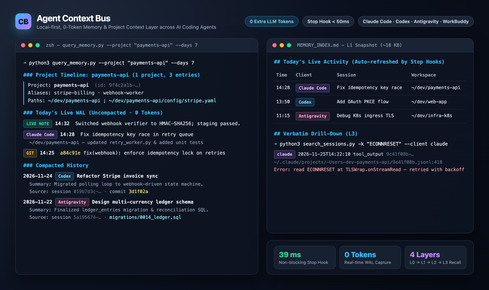
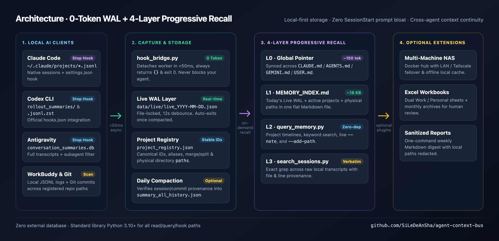

<div align="center">

# 跨端 AI 记忆中枢 · Agent Context Bus

**告别每次切换 AI 编程工具都要重新交代背景。**

本地优先、**0 额外 Token** 的跨 Agent 实时记忆层、**SQLite FTS5** 检索引擎与项目上下文总线，原生打通 **Claude Code**、**Codex CLI**、**Antigravity** 与 **WorkBuddy**。

[](LICENSE)
[](https://github.com/SiLeDeAnSha/agent-context-bus/releases/tag/v0.5.1)
[](https://www.python.org/)
[](#工作原理)
[](#0-token-实时层与官方-stop-钩子)

[English](README.md) | **简体中文**

</div>

---

<p align="center">
  
</p>

## 为什么做 Agent Context Bus？

同时用 **Claude Code**、**Codex**、**Antigravity** 和 **WorkBuddy** 写代码时，每个客户端的聊天记录都是孤岛。中途切工具，你不得不反复告诉新 Agent：仓库在哪个目录、刚才改了哪个配置文件、十分钟前报的什么错、上周定过什么架构硬约束。

**Agent Context Bus** 将各端本地会话、Git 提交、实时笔记与长期决策统一织成一层轻量、**本地优先**、**零外部依赖**的记忆总线——不需要部署向量数据库，不上传私有代码，也不往每次对话开头塞臃肿提示词。

- **0 额外模型 Token 的高密度实时层**：通过 `Claude Code`、`Codex`、`Antigravity` 官方 `Stop` Hook 在 **<50ms** 内异步触发，仅读取各端原会话末尾 64 KB 提取 `last_user_prompt`、`last_assistant_summary`、`touched_files` 与今日 Git 提交写入当日 WAL（`data/live/live_YYYY-MM-DD.json`）。
- **零依赖 SQLite FTS5 检索引擎（`search_fts.py`）**：派生索引 `data/search_index.db`（`unicode61` + `trigram` + BM25 + RRF + 时效/决策加权）覆盖全量历史日报、实时层、归档 `--note` 笔记、长期决策与近 30 天原会话增量索引，本地与远程均支持 `--exact` 精确子串回退。
- **独立长期决策与避坑账本（`decisions.py`）**：用 `data/decisions.json` 沉淀 `project` / `global` 维度的 `decision` / `constraint` / `pitfall`，支持显式 `supersede` 淘汰链（防环、防重复替代）、软删除墓碑与夜间自动候选抽取。
- **全链路落盘前凭据脱敏（`redact.py`）**：在实时层、原始归档、LLM 汇总输入与 NAS 分片写入前自动脱敏 PEM 私钥、JWT/Bearer、OpenAI/Anthropic/GitHub/AWS/Google/Slack/HF 密钥、URL 密码与 Cookie，且不误杀 40 位 Git SHA 与本地文件路径。
- **零 `SessionStart` 上下文污染**：默认只做单向写入、绝不强行注入上下文，只有当你问“上次做到哪了 / 接着做”时才按需下钻。
- **稳定项目身份 + 物理路径注册表**：把零散会话名与别名收敛到同一个 `project_id`，直接绑定项目目录与关键配置文件（`--add-path`），任何 Agent 一秒定位真实路径。
- **纯 Python 标准库零依赖**：首次导入、实时 WAL、FTS5 检索、决策账本、Hook、体检自愈（`--doctor`）与原会话搜索只需系统自带 **Python 3.9+**，**无需 pip 依赖、无需 NAS、无需模型 API Key**。

---

## 30 秒快速上手

```bash
git clone https://github.com/SiLeDeAnSha/agent-context-bus.git
cd agent-context-bus

# 1. 自动扫描本机 Claude Code / Codex / Antigravity / WorkBuddy 历史并导入最近 7 天（零依赖）
python3 onboarding.py

# 2. 按项目名/别名查询完整时间线 + 今日实时动态 + 长期决策 + 已登记路径
python3 query_memory.py --project "<项目名称或别名>"

# 3. 通过 SQLite FTS5（中文 trigram + BM25）跨项目/决策/笔记检索
python3 query_memory.py --keyword "算力 告警" --limit 10

# 4. 一键全链路体检（Python / FTS5 / 四端 Hook / JSON 完整性 / NAS 线路；加 --fix 自动无损修复）
python3 query_memory.py --doctor
```

> **Windows PowerShell**：将 `python3` 替换为 `python`。读取 Codex 的 `.jsonl.zst` 压缩归档需要 Python 3.14+ 或 `pip install zstandard`。

---

## 支持的客户端

四端采集逻辑已模块化拆分至 `adapters/{antigravity,codex,claude,workbuddy}.py`：

| 客户端 | 原生会话采集 | 0-Token 实时 WAL | 官方 `Stop` Hook | 原会话全文搜索 | 全局规则同步 |
|---|:---:|:---:|:---:|:---:|:---:|
| **Claude Code**（`~/.claude/`） | ✅ | ✅ | ✅ `settings.json` | ✅ | ✅ `CLAUDE.md` |
| **Codex CLI**（`~/.codex/`） | ✅ | ✅ | ✅ `hooks.json` | ✅ | ✅ `AGENTS.md` |
| **Antigravity**（`~/.gemini/antigravity/`） | ✅ | ✅ | ✅ `~/.gemini/config/hooks.json` | ✅ | ✅ `GEMINI.md` |
| **WorkBuddy**（`~/.workbuddy/`） | ✅ | ✅ | 🟡 增量文件扫描 | ✅ | ✅ `USER.md` |
| **本地 Git 仓库** | ✅ | ✅ | 🟡 自动扫描提交 | — | — |

---

## 工作原理

<p align="center">
  
</p>

### 四层渐进式检索（按需下钻，控制 Token 体积）

| 层级 | 文件 / 命令 | 体积 / 成本 | 使用场景 |
|---|---|---|---|
| **L0** | 全局规则指针（`CLAUDE.md` / `AGENTS.md` / `GEMINI.md` / `USER.md`） | ~150 Token | 告知各端 Agent 记忆中枢入口与检索纪律 |
| **L1** | `MEMORY_INDEX.md` | ~20 KB 纯 Markdown | 首选速览：今日多机实时动态 + 活跃决策 + 进行中项目 + 关键物理路径 |
| **L2** | `query_memory.py`（`--project` / `--keyword` / `--decisions` / `--date` / `--raw`） | 0 Token，<100ms | FTS5 BM25 检索、项目演进时间线、决策淘汰链与出处校验 |
| **L3** | `search_sessions.py`（`--keyword` / `--client` / `--session-id`） | 0 Token | 近 30 天 FTS5 加速 + 流式全量检索原始转录中的报错、命令与工具输出 |

---

## 0-Token 实时层与官方 `Stop` 钩子

一条幂等命令即可同时装配 **Claude Code**、**Codex**、**Antigravity** 与 **WorkBuddy** 的全局规则、Skill 软链和非阻塞 `Stop` Hook：

```bash
# 只读检查四端规则、Skill 软链与 Hook 状态
python3 skills/daily-memory/scripts/sync_global_rules.py --check

# 一键幂等同步全局规则、Skill 软链并安装 Stop Hook（不覆盖原有配置）
python3 skills/daily-memory/scripts/sync_global_rules.py --sync-skills --sync-hooks

# 随时一键关闭/卸载 Hook
python3 skills/daily-memory/scripts/sync_global_rules.py --disable-hooks
```

**`hook_bridge.py` 安全保障**：
- 后台脱钩拉起 `live_memory.py`（`start_new_session=True`），主进程 **<50ms** 内输出 `{}` 并退出码 `0`，绝不阻塞或卡死对话。
- 内置跨进程文件锁 + 12 秒本地防抖窗口（及 30 秒远端 NAS 推送防抖），连续工具调用不会频繁扫盘或刷接口。
- 写入本地 WAL 或推送 NAS 前自动经过 `redact.py` 凭据脱敏。
- 次日压实归档至 `summary_all_history.json` 后，该日实时会话自动从 `MEMORY_INDEX.md` 顶部退出以保持轻量体积，而 `--note` 笔记会同步保留进日报、FTS5 与常规精确检索，归档后依然随时可查。

### 日常高频命令速查

```bash
# 随时记一笔关键结论（可选附带路径），秒级刷新 MEMORY_INDEX.md（自动脱敏并同步 NAS）
python3 query_memory.py --note "代理分流规则优化" "新增 Meta AI 走犹他独享住宅 IP 分流" \
  --note-path ~/projects/proxy-rules ~/.config/clash/script.js

# 记录长期决策 / 硬约束 / 避坑结论，显式淘汰旧方案（supersede 链）或软删除
python3 query_memory.py --decision "代理分流规则优化" "仅高优先级域名走住宅 IP，避免污染全局 TUN" --kind constraint --tags clash,tun
python3 query_memory.py --global-decision "macOS 互联网共享无法转发 utun 流量，车机抓包需切代理模式" --kind pitfall
python3 query_memory.py --decisions
python3 query_memory.py --supersede <旧决策ID> "<新替代方案>"
python3 query_memory.py --forget-decision <决策ID>

# 中文模糊 + BM25 相关性检索（SQLite FTS5，加 --exact 退回严格子串匹配，本地与远程均生效）
python3 query_memory.py --keyword "算力 告警" --limit 15
python3 query_memory.py --keyword "算力 告警" --exact
python3 query_memory.py --reindex

# 一键体检（查环境 / FTS5 / 四端 Hook / JSON 完整性 / NAS 5 级线路；加 --fix 无损自愈）
python3 query_memory.py --doctor --fix

# 强制触发一次 0-Token 实时增量扫描（四端尾部上下文 + 今日 Git，配置 NAS 时自动推送）
python3 query_memory.py --live-sync

# 为项目登记、移除或覆盖物理目录与核心配置文件路径
python3 query_memory.py --add-path "代理分流规则优化" "~/projects/proxy-rules" "~/.config/clash/script.js"
python3 query_memory.py --remove-path "代理分流规则优化" "~/projects/old-rules"
python3 query_memory.py --set-paths "代理分流规则优化" "~/projects/proxy-rules"

# 项目别名合并 / 拆分纠错（支持旧别名 ID 精准恢复）
python3 query_memory.py --project-review
python3 query_memory.py --merge-projects "跨端 AI 记忆中枢" "Agent Context Bus" "daily-summary"
python3 query_memory.py --split-project "daily-summary"

# 按客户端或会话 ID 下钻原会话原文片段
python3 search_sessions.py --keyword "ffprobe" --client claude --date 2026-11-25 --limit 5
```

---

## 可选扩展模块

上述全部核心能力在单机上零依赖开箱即用；如需跨电脑同步、Web 看板或双账本报表，可按需开启以下扩展：

<details>
<summary><strong>1. 多机中心同步（飞牛 NAS / Docker Hub + 8 工具 MCP + Web 看板）</strong></summary>

- 将 `server/` 部署到局域网 NAS 或云服务器，多台电脑（Mac / Windows / Linux）按机器分片推送 `raw` 轨迹，无写入冲突且自动持久化迁移前旧档案分片：
  ```bash
  python3 collect.py --yesterday --missing --skip-pushed --push --machine win-desktop
  ```
- **5 级自动切线**：客户端自动按 **LAN → Tailscale → IPv6 HTTPS → IPv4 HTTPS → 本地离线缓存** 优先级切换，提供 `--probe` 测速、`--sync-cache` 同步与多机当日实时 WAL 推送（`POST /api/v1/live/push`）。
- **迟到设备自动补汇总 & Mac 多槽位休眠兜底**：NAS 收到迟到设备补传的已完成工作日 raw 后，经 `120s` 防抖自动触发补汇总（`SUMMARIZE_PUSH_DEBOUNCE_SEC` 可配），定时汇总也会自动比对新机器分片；`deploy/setup_mac_collector.sh` 默认装配 `08:55` 主槽 + `10:30 / 14:00 / 19:00` 休眠幂等兜底槽。
- **8 个 Streamable-HTTP Remote MCP 工具（`/mcp`）**：5 个只读查询工具 + 3 个 `write_token` 保护的写工具（`memory_add_note`、`memory_register_path`、`memory_add_decision`）。
- **零构建瑞士极简风 Web 看板（`GET /ui`）**：Bearer Token 仅存 `sessionStorage` 并启用 `nosniff` / `no-referrer` / CSP 安全头，覆盖总览与多机实时层、FTS5 搜索、项目路径一键复制、决策与避坑管理。完整部署见 [`deploy/NAS_DEPLOYMENT.md`](deploy/NAS_DEPLOYMENT.md)。

</details>

<details>
<summary><strong>2. 双账本 Excel 日报、分月归档与脱敏对外周报</strong></summary>

安装 `pip install -r requirements.txt`（`openpyxl`）并复制 `config.example.json` 为 `config.json` 后可启用：

- **正式工作 / 个人折腾严格分表**：自动写入 `每日工作汇总.xlsx`（3 Sheet）与 `个人技术与折腾汇总.xlsx`（4 Sheet），同步维护按月分卷（`YYYY-MM/`）、自动入库夜间抽取的 `candidate_decisions` 并刷新 FTS5。
- **进展出处核验 & 实时笔记承接**：`write_excel.py` / `summarizer.py` 对每条 `session` / `commit` / `file` 引用按当日原始档案校验，并将 `live_notes` 完整带入日报汇总。
- **跨平台脱敏对外周报**：`python3 export_report.py --days 7` 自动剥离个人项、高危凭据、Windows 盘符路径（`C:\Users\...`）与含空格 macOS/Linux 用户路径，输出到 `对外报告/`。

</details>

---

## 隐私、安全与测试

- **100% 本地优先**：所有会话、项目注册表、决策账本、FTS5 派生索引与实时 WAL 均保存在被 `.gitignore` 忽略的 `data/` 目录。
- **落盘前凭据脱敏**：高危 Token、API Key 与私钥在落盘、调用 LLM 或推上 NAS 前自动替换为 `[REDACTED:...]`。
- **零遥测**：除你主动配置的自建 NAS 或可选 LLM 汇总 API 外，无任何外部网络请求。
- **完整单元测试**（纯标准库与全量套件均通过）：

```bash
# 纯 Python 3.9+ 标准库核心回归测试（零 pip 依赖）
python3 -m unittest -v test_v05_upgrades.py

# 全量测试套件（含 Excel 双账本测试，需安装 openpyxl）
python3 -m unittest discover -v -p "test_*.py"
```

---

## License

[MIT](LICENSE) © 2026 SiLeDeAnSha
